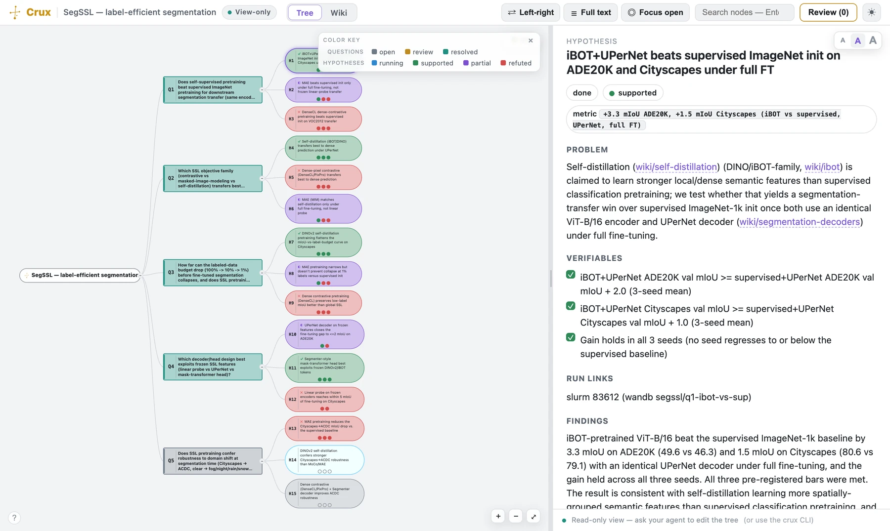

# crux

[](.github/workflows/clone-count.yml)
[](https://mforoozz.substack.com/p/agents-on-leash)

crux is a lab notebook for computational research that you do with an AI coding agent, such
as Claude Code. While you talk to the agent, crux records the questions you ask, the
hypotheses you test, and the results. Each result links to the file that holds its numbers.
The notebook is a folder of plain markdown files inside your project repository. crux calls
this folder the vault.

## An example session

The example below comes from [`scaling_vault`](skills/crux/examples/scaling_vault), one of the
bundled example vaults. Its numbers are invented for the demonstration.

You ask the agent whether a model trained on twice the data beats a larger model trained on
the original data. The agent records the question:

```
q1  Does more data beat a better model?
```

The agent proposes a hypothesis. Before any run, it writes down the result that the
hypothesis predicts:

```
h1  Twice the data beats a better model
    expect: accuracy improves by at least 2.0 points, in all 3 repeat runs
```

The run finishes. The data arm scores 49.6 and the larger model scores 46.3, so the gain is
3.3 points. The agent records a finding on `h1` with its direction, its confidence, and its
evidence:

```
f1  supports, strong
    evidence: results/h1/report.md, results/h1/metrics.json
```

You point out that twice the data also costs about twice the training compute. The agent adds
a second hypothesis, which repeats the comparison at equal compute:

```
h2  The advantage survives at equal compute
    expect: the data arm still wins when both arms get the same training compute
```

At equal compute, the data arm scores 43.3 and the larger model scores 47.9. The difference is
-4.6 points (interval -6.0 to -3.2, 3 runs). The finding on `h2` is mixed with weak
confidence, and the answer to `q1` becomes "not on a level budget". The full record is in
[`q1`](skills/crux/examples/scaling_vault/q1_does_more_data_beat_a_better_model.md) and in
[`results/h2/metrics.json`](skills/crux/examples/scaling_vault/results/h2/metrics.json).

## Main features

crux does four things.

1. Each hypothesis states its expected result before the run. The engine refuses a
   hypothesis without an expectation (`crux hypothesize --expect`). After the run, the agent
   judges the evidence against that expectation. Fixed rules then cap the confidence. If a
   finding supports its hypothesis and the null hypothesis is not ruled out, the engine stores
   the confidence as weak. The null hypothesis is the simplest other explanation of the
   result. If a control failed, the agent caps the finding at weak, whatever its direction. A
   node's state follows from its findings: open (no finding), leaning (weak or moderate),
   settled (strong), or parked (dropped). Nobody closes a node by hand.

2. Each number traces to a result file. A finding links to its evidence files under
   `results/`. crux can build slides (`prezit`) and a short paper (`storify`) from a question
   and the nodes under it. Each number on a slide or in the paper carries the address of the
   result file it came from. The deck or paper records the SHA-256 hash of each file it read.
   `crux deck --verify deck.html` and `crux story --verify paper.tex` re-read those files and
   fail if any file or number changed.

3. The agent records the notebook from the conversation. You do not write the entries.
   The agent records questions, hypotheses and findings as they come up. Each new question or
   hypothesis must state how its answer would change the answer of its parent question
   (`--bears`). In Claude Code, a session-start hook also starts one background capture run.
   This run reads the part of the transcript that no earlier run read, and it records what
   the agent missed. Uncertain items wait in a pending list. `/crux-wrap` shows you that list,
   and you accept or reject each item. You correct any entry in plain words, and your
   correction wins.

4. You can read the notebook in a browser without any setup. `crux serve` starts a
   read-only web view of the vault on your own machine. It needs only Python, and it never
   writes to the vault. Two finished example vaults ship with the repository.

## Try it

You need Python 3.8 or later and git. The engine uses only the Python standard library.

```bash
git clone https://github.com/mehdiforoozandeh/crux
cd crux
./crux serve --dir skills/crux/examples/scaling_vault
```

Open the URL that the command prints. `scaling_vault` has 3 questions and 7 hypotheses, and
it contains the example session above. The second example,
[`sortlab_vault`](skills/crux/examples/sortlab_vault), is a finished project: one person asks
which of the sorting functions they wrote is fastest, and whether any of them beats the
built-in sort. It needs no background in any field.

```bash
./crux serve --dir skills/crux/examples/sortlab_vault
```

The command picks a free port from 8787 upward. `./crux status` prints the same tree in the
terminal when you run it inside a vault.

<p align="center">
  <picture>
    <source media="(prefers-color-scheme: dark)" srcset="assets/screens/cockpit-tree-dark.webp">
    
  </picture>
</p>

<p align="center"><sub>The browser view over <a href="skills/crux/examples/segssl_vault">segssl_vault</a>, a larger example vault.</sub></p>

## Install

Install the crux skills into your agent with the [skills.sh](https://www.skills.sh) CLI. This
path needs Node.js, and it works with Claude Code, Cursor, Codex, Windsurf, Copilot CLI and
other compatible agents.

```bash
npx skills add mehdiforoozandeh/crux --all
```

Alternatively, clone the repository and link the skills into your agent:

```bash
git clone https://github.com/mehdiforoozandeh/crux
cd crux && ./install.sh
```

The clone path also installs the crux subagents and the Claude Code hooks. Background capture
needs these hooks. Restart your agent after you install. Then start a vault in your project
with `crux init "My project"`, or ask the agent to start one. `./crux selftest` checks the
install. The [installation guide](INSTALL.md) covers scopes, per-agent notes, updates and
troubleshooting.

## Other parts

crux has three more parts. You do not need them for the notebook.

- A literature wiki. The agent compiles papers that you put under `raw/` into linked markdown
  pages under `wiki/`. The pages follow
  [Karpathy's LLM-wiki pattern](https://gist.github.com/karpathy/442a6bf555914893e9891c11519de94f).
  A citation crawl over [OpenAlex](https://openalex.org) starts from papers you choose and
  ranks related papers that the wiki does not have yet (`crux lit crawl`). Project results
  never enter the wiki. Skills: `crux-wiki`, `crux-litsearch`.
- A task list (`crux task`). It holds work that is not a claim, such as a data download. A
  task closes only with a link to its output.
- An optimization loop (`crux auto`) for a question with one scalar metric. You write a plan
  with the files the agent may edit, a frozen scorer, and a target. In each attempt, the
  agent edits the code and the scorer scores it. The engine records each attempt as a
  hypothesis with a finding. It extends [autoresearch](https://github.com/karpathy/autoresearch).
  For a working example, see
  [`examples/autopilot/circle-packing`](examples/autopilot/circle-packing), which packs 26
  circles in a unit square. Skill: `crux-autopilot`.

## Design limits

The engine handles IDs, tree consistency, derived states and the confidence caps. It never
judges evidence. The agent judges evidence, and you can overrule it. The agent does not start
an optimization run, start compute you did not ask for, or merge into `main`. Those stay with
you.

## Contributing

Contributions are welcome. See [CONTRIBUTING.md](CONTRIBUTING.md).

## License

[MIT](LICENSE) © Mehdi Foroozandeh
