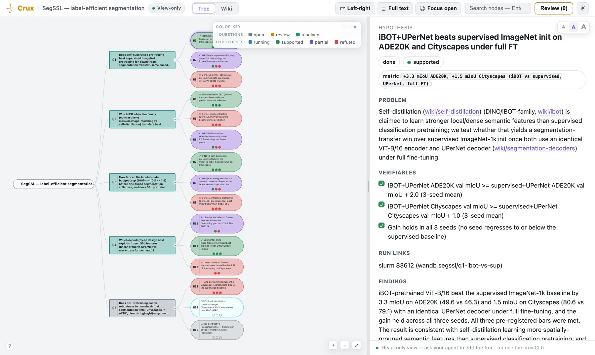
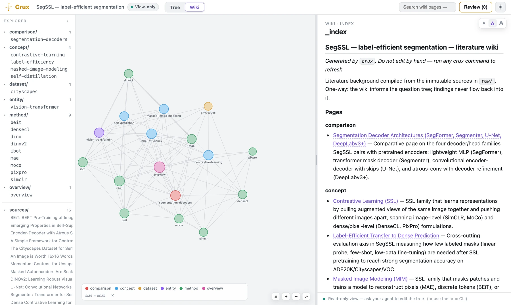

# Crux

[](.github/workflows/clone-count.yml)

`crux` is an open-source toolbox for computational research with AI agents.

<p align="center">
  
</p>

<p align="center"><sub>Three of crux's modules. <b>Knowledge base:</b> literature compiled into a wiki that agents read. <b>Research tree:</b> questions and hypotheses, each evaluated against checks defined before the run. <b>Automated research loop:</b> autopilot iterates on code against a metric.</sub></p>

## Motivation

AI coding agents can write code, run experiments and summarize results faster than a
researcher can follow. Over weeks and months, it becomes hard to track which questions a
project asked, what was tested, what the evidence showed, and which decisions the researcher
made. `crux` gives agents a shared structure for this work and gives the researcher a way to
review it.

## What crux provides

`crux` consists of specialized agents and skills, a deterministic engine, and a read-only
browser interface (the **cockpit**). All state is stored as plain markdown in a vault inside
the project repository. It is organized into the modules below.

### Knowledge base

A literature wiki that agents consult for background, baselines and metrics. Following
[Karpathy's LLM-wiki pattern](https://gist.github.com/karpathy/442a6bf555914893e9891c11519de94f),
sources are compiled into cross-linked markdown pages. A citation crawl over
[OpenAlex](https://openalex.org) starts from seed papers chosen by the researcher and ranks
related work that is not yet in the wiki. The wiki contains published work only; project
results are kept in the research tree. Skills: `crux-wiki`, `crux-litsearch`.

### Research tree

A tree of research questions and the hypotheses that test them.

- **Questions** can nest. The researcher closes a question when the evidence beneath it is sufficient.
- **Hypotheses** each have a **null** and **pass/fail checks (verifiables) defined before the
  run**, e.g. *"ADE20K val mIoU ≥ supervised + 2.0, 3-seed mean"*. The engine derives the
  verdict from these checks.

Agents add and update the nodes; the researcher approves the decisions.

### Taskhub

A task list for work that is not a claim, such as downloading data, writing a scorer or
launching a run. Each task declares the tasks that block it, and a task can only be marked
done with a link to its output. Completing an experiment — a task whose output is evidence
about a hypothesis — requires the researcher's acceptance (`crux task accept`).

### Autopilot

An optimization loop for questions with a single metric, such as a loss or a runtime. It
extends [autoresearch](https://github.com/karpathy/autoresearch). The researcher and the
agent first write a flight plan with the objective, baselines, limits and guidance. In each
attempt, an agent changes the code, the program is run and scored, and the attempt is
recorded in the research tree as a hypothesis with a verdict. The next attempt is selected
with the tree-search rule from Google's [ERA](https://www.nature.com/articles/s41586-026-10658-6),
which balances refining the best attempt against exploring less-visited ones. Skill:
`crux-autopilot`; command: `crux auto`.

### Engine

A stdlib-only Python engine handles IDs, tree consistency, the roll-up of evidence, and a
review gate. Agents drive the engine through its CLI. Decisions on direction, thresholds, and
when a question is answered remain with the researcher (the PI).

## Install

Needs Python ≥ 3.8 (the engine is stdlib-only) and `git`; the `npx` path also needs
Node.js. Install the crux skills with any [skills.sh](https://www.skills.sh)-compatible
agent — Claude Code, Cursor, Codex, Windsurf, Copilot CLI, and others:

```bash
npx skills add mehdiforoozandeh/crux --all
```

Or clone and symlink them into your agent's skills dirs:

```bash
git clone https://github.com/mehdiforoozandeh/crux
cd crux && ./install.sh
```

Restart your agent and you're set — `./crux selftest` checks the install. Scopes,
per-agent notes, updating, and troubleshooting: **[installation guide](INSTALL.md)**.

## Try it

No agent, no dependencies, nothing to configure — open the cockpit over the bundled
example vault from a fresh clone:

```bash
git clone https://github.com/mehdiforoozandeh/crux
cd crux && ./crux serve --dir skills/crux/examples/sortlab_vault
```

That's [sortlab_vault](skills/crux/examples/sortlab_vault):
one person asking which of the sorts they wrote is fastest, and whether they can beat the one
the language ships. Pan the status-colored tree and open any hypothesis's evidence ledger,
flip to the **Wiki** tab for the literature graph, and to **Taskhub** for the plans and runs
behind the results. (Port taken? `--port 8890`.) The screenshots below are
[segssl_vault](skills/crux/examples/segssl_vault), a lived-in research vault.

## The cockpit

Your vault opens in **Obsidian**, but crux has a purpose-built home for it. **`crux serve`**
is a dependency-free, **read-only** browser **cockpit** with one tab per module — **Tree**,
**Wiki**, **Taskhub** and **Autopilot**. On the Tree tab you pan / zoom / search the live
tree, focus one question, watch the review gate, read any node's evidence ledger, and open a
hypothesis's **report — rendered markdown, figures and all — beside the tree**. Edits still
go through your agent or the CLI.

<p align="center">
  <picture>
    <source media="(prefers-color-scheme: dark)" srcset="assets/screens/cockpit-tree-dark.webp">
    
  </picture>
</p>

<p align="center"><sub>The <b>cockpit</b> over the <a href="skills/crux/examples/segssl_vault">segssl_vault</a> example — the status-colored tree (branches collapse/expand) and a hypothesis's <b>evidence ledger</b> (verifiables · metric · run link · finding). Read-only; every edit goes through your agent or the <code>crux</code> CLI. <em>(Real screenshot; it matches your GitHub light/dark theme.)</em></sub></p>

The Wiki tab draws the **knowledge base** as a graph **colored by category, sized by links,
cross-linked into the question tree**, flowing one way: literature → wiki → tree.

<p align="center">
  <picture>
    <source media="(prefers-color-scheme: dark)" srcset="assets/screens/wiki-graph-dark.webp">
    
  </picture>
</p>

<p align="center"><sub>The <b>literature wiki</b> as crux's own knowledge graph — pages by category, sized by links, cross-linked with the question tree. Compiled by the <code>crux-wiki</code> skill from PI-curated sources.</sub></p>

## Contributing

Contributions are welcome; see [CONTRIBUTING.md](CONTRIBUTING.md).

## License

> *Crux* — the Southern Cross, the sky's most reliable signpost. It keeps you oriented to the **crux** of each question.

[MIT](LICENSE) © Mehdi Foroozandeh
